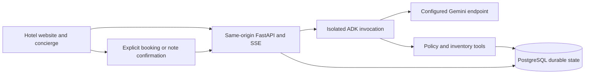

# Smart Hotels System — development plan

## 1. Product goal

Build a working system for one hotel: a website, an AI assistant answering from hotel information, availability search and an explicit reservation flow. Run it on Google Cloud with Gemini through Vertex AI.

The first version uses demo hotel data and clearly labels demo reservations. The reference project is a source of useful ideas, not a specification to copy or audit. Consult it only to resolve a concrete implementation question. Commit comparisons, feature parity and upstream requirement mappings are not delivery requirements.

## 2. Architecture

Retained for now from the previous plan. The detailed source paths, contracts and controls below describe the reference and possible implementation choices; they do not require importing the application, matching its internals or completing every proposed extension. Section 3 defines the delivery scope. Google Cloud Run, Cloud SQL for PostgreSQL and Vertex AI are the deployment direction; exact configuration is decided when needed.

- Initial stack follows the reference: static browser JavaScript, FastAPI, async PostgreSQL access, Google ADK and a configurable Gemini endpoint. Record tested versions in lockfiles after local verification.
- Serve website and API from one origin. POST questions with a client-generated turn UUID; stream provisional output using fetch/SSE; persist final state before signaling completion.
- PostgreSQL owns durable application state. The imported schema has sessions with a current conversation UUID, mutable turn-status rows, published policy versions, villas, nightly inventory, demo reservations and note drafts. Separate conversation records, richer durable attempt/status data and shared admission counters are proposed T09 extensions, not existing upstream tables.
- Keep SDK types inside the agent adapter. Tools return structured data; the browser renders validated facts and sanitized text.
- A single container plus managed PostgreSQL is the proposed deployment direction. Confirm provider, account, region, model availability and budget in T01; do not reuse upstream's account.
- A real PMS/booking-provider adapter is deferred. No paid calls or infrastructure changes are authorized by this document alone.



Proposed layout:

```text
frontend/                 site, chat, villa and booking pages; browser tests
backend/app/              API, agent adapter, evidence, inventory, reservations
backend/migrations/       ordered transactional SQL and migration ledger
backend/tests/            contract and real-PostgreSQL integration tests
hotel/                    reviewed demo policies, catalogue and inventory
evals/                    smoke, holdout and failure cases
scripts/                  PowerShell/local run and validation helpers
infra/                    deployment, maintenance and rollback configuration
docs/                     local requirements, architecture and booking contract
compose.yaml              isolated local PostgreSQL
Dockerfile                frontend and backend in one image
PLAN.md          this plan and task reports
```

### 2.1. Current source structure and adaptation ownership

These are existing upstream paths at the pinned SHA. Import the functioning baseline in T02, then adapt and verify the indicated modules in T03–T08. Do not build a second implementation beside the imported one. Keep the compact layout unless a concrete change requires a split; `routes/`, `sessions.py` and `turns.py` are not current upstream modules.

| Existing paths | Actual responsibility | Adaptation tasks |
| --- | --- | --- |
| `backend/app/main.py` | App factory/lifespan, ownership and Origin checks, all API/page routes, turn admission/persistence and SSE cleanup | T04, T07–T09 |
| `backend/app/agent.py` | Per-invocation Agent, HotelTools, InMemorySessionService and Runner; completed-history reconstruction; date context | T05, T06, T08 |
| `backend/app/tools.py` | Six structured tools, invocation-local evidence/cards/draft, call and evidence budgets | T03, T05, T06, T08 |
| `backend/app/db.py` | Async pool, token hashing, migration ledger/lock and explicit migrate/seed CLI | T02, T04, T11 |
| `backend/app/seed.py` | Catalogue/header validation, immutable policy revisions, atomic policy publication/withdrawal | T03 |
| `backend/app/inventory.py` | Validated villas/fixture import and deterministic whole-stay SQL | T06 |
| `backend/app/reservations.py` | Owned lookup, booking locks/idempotency, draft lifecycle and note confirmation | T08 |
| `backend/app/settings.py`, `backend/.env.example` | DB/model/project/location/origin/cookie configuration; property timezone still hardcoded elsewhere | T02, T05, T08, T11 |
| `backend/migrations/001_policies.sql`–`004_reservations.sql` | Ordered current schema and indexes; preserve lineage and add later changes as new migrations | T02–T04, T06, T08, T09 |
| `frontend/index.html`, `villa.html`, `book.html`; four CSS files | Three pages and shared widget markup/styling; nested pages use `<base href="/">` | T07, T08 |
| `frontend/js/chat.js`, `guest-session.js`, `reply.js` | Shared cookie initialization, history and SSE, Stop/reset, safe Markdown and structured result rendering | T04, T07–T09 |
| `frontend/js/site.js`, `villa.js`, `book.js` | Static showcase/video, API-backed detail page, review/confirm/reference recovery | T06–T08 |
| `hotel/catalogue.json`, `policies/*.md`, `villas.json`, `availability.json` | Seven reviewed policy documents, two fictional villas and dated occupancy fixtures | T03, T06 |
| `backend/tests/*.py`, `frontend/tests/*` | SDK boundary, PostgreSQL/ASGI behavior and browser-module regressions | T02–T10 |
| `backend/evaluate.py`, `evals/demo-smoke.json`, `evals/guest-questions.json` | Direct-runner live smoke versus broader expected-behavior fixtures; distinct dataset formats | T10 |
| `.github/workflows/checks.yml`, manifests/lockfiles, `compose.yaml`, `scripts/*` | Existing local/CI installation and checks; website-only startup is distinct from live API startup | T02, T10 |
| `README.md`, `docs/*`, `demo.md`, `resources/*`, upstream `AGENTS.md` | Product/design/build evidence and recording context; remove upstream-only delivery instructions | T01, T10–T12 |

Proposed-only artifacts include `Dockerfile`, `infra/`, deployment/retention jobs and `docs/bookings/spec.md` (deleted upstream). Do not describe those as imported working infrastructure.

### 2.2. Existing HTTP and streaming contracts

Source: pinned [`backend/app/main.py`](https://github.com/ai-developer-community/hotel-ai-agent/blob/269d6c1f989715aff72080fa90ba02fd3f21fd1f/backend/app/main.py). Preserve these contracts initially; any extension must be explicit and tested.

| Route | Current contract |
| --- | --- |
| `GET /`, static files | Public website; API/page routes are registered before the root static mount |
| `GET /villas/{villa_id}` | Public shared detail template; unknown villa returns 404 |
| `GET /book` | Public booking review page; serving the page never creates a reservation |
| `GET /api/health` | Database-backed health; no model call |
| `POST /api/session` | Exact Origin required; creates/reuses a guest cookie |
| `POST /api/conversation` | Origin + owned unexpired session; rotates conversation UUID when no active turn |
| `GET /api/history` | Owned unexpired session; current conversation's latest twenty completed turns |
| `GET /api/sources/{document_id}/{revision}` | Public published revision as plain text; no private documents |
| `POST /api/chat` | Origin + owned session; `{turn_id, message}`; completed duplicate UUID currently returns 409 |
| `GET /api/availability` | Public read-only full-stay query with exact dates and total guests |
| `GET /api/villas/{villa_id}` | Public validated villa facts |
| `POST /api/bookings` | Origin + owned session; `{request_id, villa_id, check_in, check_out, guests}`; explicit confirmation only |
| `GET /api/bookings/{reference}` | Owned session required; reference alone grants no access |
| `POST /api/requests/{request_id}/confirm` | Origin + owned session; validates the current conversation and completed draft-producing turn |

- SSE sequence: `turn_started` → zero or more `text` events → committed `result` → `done`; failures emit a safe `error`. `result` contains the answer, validated sources, latest availability and optional hotel-request draft.
- Stop uses browser `AbortController`, not a dedicated Stop route. A response-lifecycle `finally` attempts bounded, shielded cleanup even if disconnect occurs before streaming starts.
- Refresh loads completed history; it does not resume a running stream. Current source has no durable turn-status/replay endpoint. T09 adds owned status/result lookup with an explicitly documented route and stale-attempt rules.
- Booking review is read-only. The same booking request UUID/payload can be retried while the page remains open; after a successful response the URL changes to `?reference=...` for owned reload recovery. Recovery after server commit but lost response plus page reload is a separate T08 extension, not proven by that successful-reference path.

### 2.3. Schema, evidence and write boundaries

| Current table/state | Existing behavior to preserve |
| --- | --- |
| `schema_migrations` | Filename ledger and transaction/advisory lock for ordered migrations |
| `documents` | `(id, revision)` key; complete body, selection metadata and publication state |
| `guest_sessions` | Hashed random cookie token, fixed 24-hour expiry, active turn/90-second busy lease and current conversation UUID |
| `turns` | UUID, owner/conversation, question, status and completed answer/sources/availability; `request_id` here links a hotel-note draft, not the booking idempotency key |
| `villas`, `inventory_days` | Public facts and per-villa/per-night open state |
| `bookings` | Fixture bookings and owned demo reservations in one table; nullable fixture references, unique guest reference/request UUID and capacity/date checks |
| `hotel_requests` | Owned through booking; current conversation; draft/pending_review/superseded; ten-minute draft lifetime |
| Invocation-local HotelTools/ADK state | Fresh per call; not a second durable history or a shared mutable guest context |

- Policy path: catalogue → listed `(id, revision)` → complete published body → verified source result. Public source URLs serve the read revision. Publication updates preserve earlier cited versions unless withdrawn.
- Availability path: validated dates/party → database full-stay check → structured cards. Missing stored nights fail the full-stay count; outside the imported horizon returns `unknown_inventory`; valid dates without a matching villa return `no_match`.
- Fixture import nuance: a declared demo horizon expands to an explicitly open nightly baseline, then applies listed overrides. That default belongs to the reviewed fictional fixture importer; do not turn missing provider/database data into assumed availability.
- Reservation path: review → explicit confirmation → request-UUID lock → matching replay or payload conflict → villa lock → full-stay/capacity/date recheck → owned reservation commit. Searches do not hold inventory.
- Note path: owned booking lookup → prepare one plain-text draft → save draft with completed answer (superseding prior drafts) → explicit guest confirmation → pending review. Reset invalidates unsent drafts through conversation identity but preserves reservations for the session.
- Policies and inventory each have their own importer transaction. The seed CLI calls them sequentially; it is not one all-or-nothing transaction across both. T02 must report each stage and document safe retry after partial seed success.
- Two villa IDs/images and `Asia/Makassar` appear in prompts, browser cards/form/showcase, settings-adjacent logic and fixtures. T06–T08 must update them together; replacing `hotel/villas.json` alone does not generalize the site.

### 2.4. Existing controls versus new release work

| Control | Existing upstream implementation | Planned delta |
| --- | --- | --- |
| Tool calls | `HotelTools.admit()` caps all six tools at eight calls | Preserve/test; separate from ADK's eight model-call limit |
| Evidence | Four distinct read bodies; 24,000 cumulative body characters; catalogue/body limits | Preserve/test; repeated reads consume the same cumulative budget |
| Chat bounds | 2,000 input characters; twenty completed turns/16,000 history characters; 2,048 output tokens; 64 KiB final result | Verify across API and adapter, rather than rebuilding all limits in T09 |
| Time/pool | 90-second app deadline; pool max five connections and three-second acquisition limits | Add deployment timeout/capacity settings and measure resource headroom |
| Duplicate turns | Existing UUID rejected with 409 | Add safe completed replay/running-status semantics in T09 |
| Crash handling | Busy lease and best-effort disconnect cleanup | Add durable stale-state/status recovery and cross-process failure tests |
| Shared budgets | No rate-counter tables or complete process admission guard | Implement in T09 |
| Operations | Local Compose/CI exist; container/cloud/retention/alert delivery remain planned | Implement in T11–T12 |

## 3. Development tasks

Tasks describe results in our application. Their IDs are retained for continuity; older review documents are historical context. No application task is marked complete by this plan update.

| Task | Deliverable | Completion check |
| --- | --- | --- |
| T01 — Starting choices | One hotel, initial language, timezone and demo scope; use placeholders for missing content | Enough information to begin development |
| T02 — Runnable foundation | Frontend, FastAPI, local PostgreSQL, configuration and startup instructions | Website and API run locally |
| T03 — Hotel information | Rooms, amenities and policies in a simple maintained source | The backend can retrieve the relevant hotel information |
| T04 — Conversations | Guest session, chat API and saved history | A guest can continue their own conversation |
| T05 — AI assistant | ADK and Gemini integration using hotel information | Answers representative questions and admits missing information |
| T06 — Availability | Date and guest-count search against stored inventory | Returns suitable options for the entire stay |
| T07 — Guest website | Hotel pages, chat, room cards and reservation navigation | The main journey works on desktop and mobile |
| T08 — Reservations | Review, explicit confirmation and reservation reference | Saves once, rechecks availability and restricts access to the guest |
| T09 — Essential safeguards | Session isolation, safe rendering, request limits, timeouts and clear errors | No cross-guest data access; failures allow a safe retry |
| T10 — Core journey checks | Focused tests of answers, availability and reservation confirmation | Main journey passes; consequential defects are fixed |
| T11 — Google Cloud deployment | Cloud Run, Cloud SQL, Vertex AI, secrets, basic logs and budget alerts | The deployed site completes the main journey with a live model |
| T12 — Launch and handover | Startup/update instructions, rollback and basic database backup setup | The first version is usable and maintainable |

Work order: T01–T02 → T03–T05 → T06–T08 → T11–T12. Add T09 safeguards and T10 checks alongside each feature, before exposing it publicly. Reuse code only when it helps delivery and its license permits it; a full import is not required.

Test our behavior in proportion to its risk. Do not reproduce the reference's full test suite, introduce arbitrary capacity targets or build advanced recovery infrastructure without a concrete need. Use local checks and human review; external coding/review agents are not part of this workflow.

## 4. Delivery stages

| Stage | Visible result | Ready when |
| --- | --- | --- |
| M1 — Local hotel assistant | A website with working model-backed chat | Answers from hotel information and handles unknown questions |
| M2 — Reservation journey | Search → room details → review → confirmation | Availability and reservation saving work correctly |
| M3 — First cloud version | The system runs on Google Cloud | Main journey, guest isolation, error handling and cost limits are checked |

The priority is a working end-to-end version. Improve it from actual use. A demo reservation is not a real hotel booking; real operation requires approved hotel content and an authoritative inventory/booking integration.

## 5. Decisions when needed

- Start with demo data from `hotel/`. Hotel name, language and timezone are configurable and can be changed later.
- Before cloud setup: Google Cloud project, region, available Gemini model and spending limit.
- For the first version, use hotel information and demo inventory from `hotel/` through application tools; no external hotel integration is required.
- Later, if needed: payments, guest accounts, multiple hotels, staff inbox, messaging channels and advanced scaling. These do not block the demo.

## 6. Short progress report

For each completed task, record only:

- Result: what now works.
- Check: what was actually checked and the outcome.
- Next: the next task or a concrete blocker.

Keep this plan focused on future development. Historical audits and detailed work logs do not belong here.

### M1 accepted — 2026-10-24

- Result: T01–T05 (SIN-58–SIN-62) are Done. The local Royal Crest Manor website has versioned hotel data, private PostgreSQL-backed conversations and a Gemini/ADK assistant with saved source references. PR #6 was merged into main at `d8438fdc08cb26ce1c2314d6311ecb532ac855f2`.
- Check: The final review read the plan, code, structure, recorded development evidence and merge state. No tests, server or model calls were run during the review or this documentation update. The earlier foreground acceptance report records a successful real-model answer and source/history recovery after refresh.
- Next: M1 is closed. Read [the M1 handover](docs/m1-handover.md) for its evidence and limits.

### M2 demo reservations under review — 2026-10-24

- Result: SIN-63 (T06) and SIN-64 (T07) are Done; PRs #8 and #9 are merged. SIN-65 (T08) adds explicit demo confirmation, safe repeat requests and owned lookup in [PR #10](https://github.com/danstoyanov/smart-hotels-system/pull/10).
- Check: The [SIN-65 verification](docs/sin-65-verification.md) records disposable PostgreSQL and desktop/mobile browser checks. Human review and merge of T08 are pending.
- Next: Review and accept SIN-65. Keep M2 open until PR #10 is merged and accepted; then continue with T09 safeguards and T10 core journey checks.
